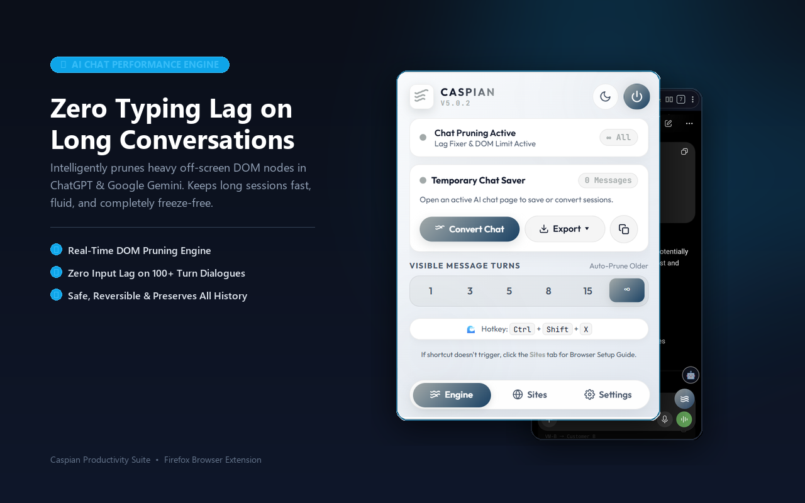
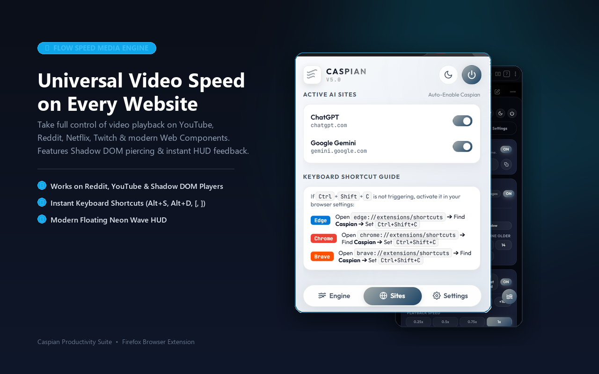
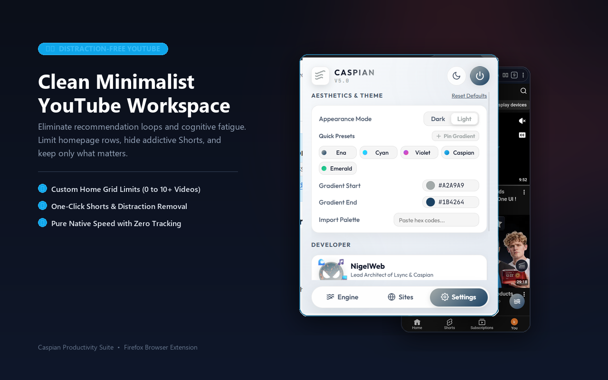
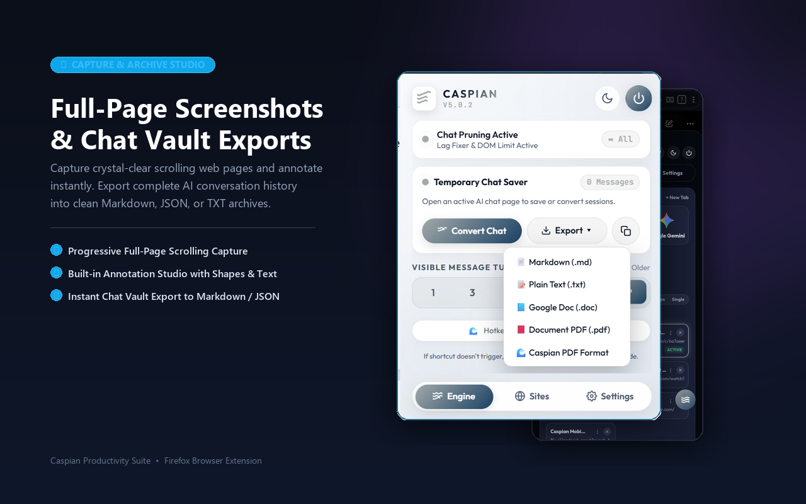
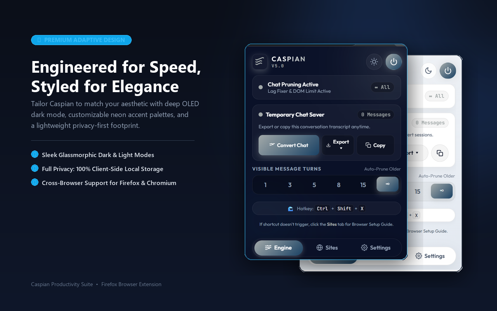
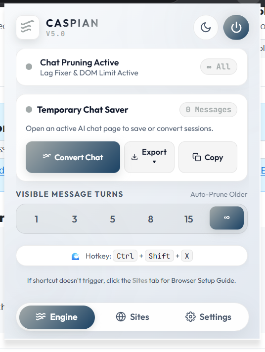
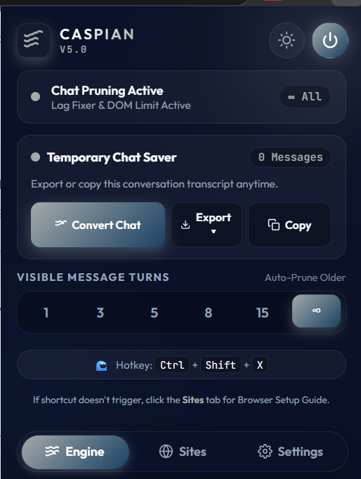
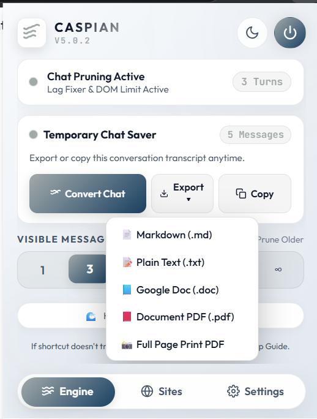
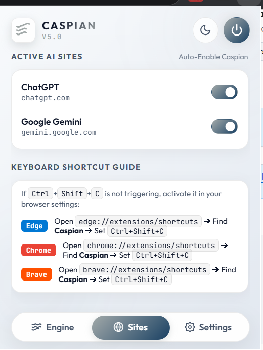
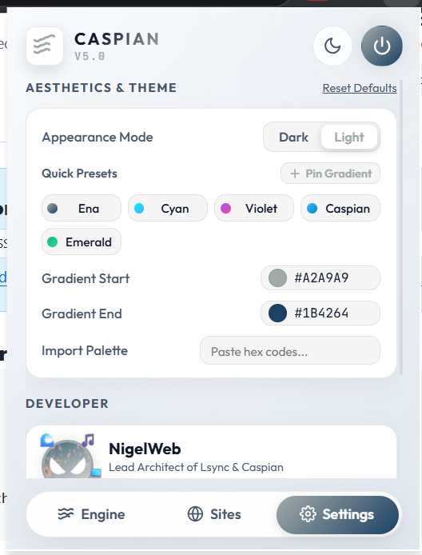

# Caspian: AI Chat Pruner, Universal Media Speed Engine & Productivity Suite

  
  
  

Caspian is a lightweight, privacy-focused productivity tool available on **[Mozilla Firefox Add-ons (AMO)](https://addons.mozilla.org/en-US/firefox/addon/caspian-fox-extension/)**, unpackaged for Chromium browsers, and as native Android companion applications (Caspian Flow & Caspian Mobile).

It addresses everyday web performance and workflow friction: eliminating typing lag in long AI conversations via real-time DOM pruning, providing universal playback speed control across all media sites, cleaning up your YouTube homepage with quick feed limits and 1-click "Not interested" actions, converting temporary chats to permanent history, and exporting conversation transcripts to clean, publication-ready formats.

---

## Platforms & Ecosystem

### 🖥️ Desktop Platforms
| Platform | Track & Version | Quick Installation Link | Highlights & Capabilities |
| :--- | :--- | :--- | :--- |
| **Google Chrome & Chromium**  Edge, Brave, Opera, Vivaldi, Arc | **v6.3.0**  Local Unpacked / GitHub ZIP | 📖 **[Chromium Installation Guide](#for-chromium-browsers-chrome-edge-brave-etc)** | Real-time DOM Pruner, Universal Flow Speed Engine, RippleFrame Screenshot Studio, Multi-Format Exporters, YouTube Minimalist Feed |
| **Mozilla Firefox**  Standard, Developer Edition, Nightly, Zen | **v6.3.1 (MV3)**  Official Add-on (AMO) & GitHub | 🦊 **[Install on Firefox Add-ons (AMO)](https://addons.mozilla.org/en-US/firefox/addon/caspian-fox-extension/)**  or [Firefox Sideload Guide](#for-mozilla-firefox) | Native Firefox Manifest V3, automatic background store updates, full chat DOM virtualization, universal media rate controller |

### 📱 Android Platforms
| App Track | Track & Version | Quick Installation Link | Highlights & Architecture |
| :--- | :--- | :--- | :--- |
| **Caspian Flow (Main)**  Latest Active Development | **v1.1.91 Beta C**  GitHub Releases & Obtainium | 📥 **[Download Latest APK](#apk-installation--setup)**  or [In-App & Obtainium Updates](#how-to-update-caspian-android) | **Browser-First Architecture**: Omnibox multi-tab browser, draggable floating action pod, AI quick docks (ChatGPT & Gemini), video remote, and session vaults (Casks) |
| **Caspian Mobile (Legacy)**  Maintenance Milestone | **v1.2.40 Stable**  GitHub Releases | 📦 **[View Legacy APKs](#apk-installation--setup)** | Dedicated standalone AI webview hub with bottom-sheet controls. *(Active feature development has transitioned to Caspian Flow)* |

---

## 🦊 Official Firefox Add-on (Now Live!)

Caspian is now officially published and available on **[Mozilla Firefox Add-ons (AMO)](https://addons.mozilla.org/en-US/firefox/addon/caspian-fox-extension/)**! Install it directly into your browser with one click to get automated updates, full privacy protection, and zero configuration.

  

### Visual Feature Demonstration

  

  

  

  

  

---

## Caspian Flow Mobile Interface Showcase

  
  
  

  
  
  

---

## Caspian Desktop Extension Showcase

  
  

  
  
  

---

## Desktop Extension Highlights (V6.3.0)

### 1. RippleFrame: Full-Page Scrolling Screenshot & Annotation Studio
Capture seamless full-length screenshots of any webpage and open them in an interactive editing studio tab:
- **Progressive Full-Page Capture**: Scrolls through the active page smoothly while freezing sticky headers to prevent duplicate navigation bars.
- **Interactive Crop Tool**: Rectangular crop box with 8-point drag handles and instant canvas resize.
- **Privacy Redaction & Blur**: Pixelate or blur sensitive passwords, emails, and tokens with an interactive box brush.
- **Blackout & Hide Boxes**: Draw solid opaque rectangles for confidential document redaction.
- **Vector Annotations**: Freehand pen, highlighters, directional vector arrows, rectangle/circle outlines, and text tags.
- **Multi-Format High-Res Exporter**: Export edited captures to `PNG`, `JPG / JPEG` (with compression quality slider), or clean `PDF` documents with custom names and location prompts.

### 2. Real-Time AI Chat DOM Pruning
Long conversation threads on ChatGPT and Google Gemini often introduce severe typing latency, frame drops, and browser memory bloat due to thousands of rendered DOM elements. Caspian dynamically virtualizes offscreen conversation messages from the active viewport using lightweight CSS rules. Typing lag is eliminated immediately while 100% of your chat history remains intact in memory.

### 3. Flow Speed: Universal Media Playback Controller
A clean, system-wide media rate controller that works on `<video>` and `<audio>` elements across any website (YouTube, Netflix, Twitch, Coursera, Udemy, Vimeo, and embedded players):
- **Precision Speed Control**: Adjust playback speed continuously from `0.25x` to `5.0x` or use instant preset pills.
- **Smart A/B Toggle (<kbd>Alt</kbd> + <kbd>S</kbd>)**: Switches between `1.00x` and your last active custom speed (e.g. `1.75x`) with a single keypress.
- **Speed Cycle (<kbd>Alt</kbd> + <kbd>D</kbd>)**: Rotates through a customizable comma-separated list of speeds (e.g. `1, 1.25, 1.5, 1.75, 2, 2.5, 3`).
- **Fine Adjustment (<kbd>]</kbd> / <kbd>[</kbd>)**: Step up or down by `0.25x`.
- **Left-Side Speed HUD**: A floating glassmorphic badge with a wave indicator appears on screen when shortcuts are pressed.
- **Toolbar Icon Speed Badge**: Live speed badge on the extension icon with an ON/OFF toggle in settings.
- **Input Protection**: Automatically disables shortcuts when typing inside search inputs, comment boxes, or editors.

### 4. YouTube Home Feed Cleaner & Instant Feedback
- **Feed Limit Control**: Limit the number of videos displayed on your YouTube homepage (in neat multiples of 3: `3`, `6`, `9`, `12`, `15`, `18`, `21`, `24`, `30`, or `∞ All`).
- **1-Click "Not Interested" Button**: Hovering over any video thumbnail reveals an instant "Not interested" button at the top-left, automatically triggering YouTube's native feedback menu without requiring extra clicks.

### 4. Universal Transcript Exporter
Export both normal and temporary conversations from ChatGPT and Google Gemini into five clean formats:
- **Styled PDF / HTML**: Formatted document with KaTeX LaTeX math equations, language-tagged syntax-highlighted code blocks, tables, and conversation badges.
- **Markdown (`.md`)**: Full Markdown transcripts with headers and code fences.
- **Plain Text (`.txt`)**: Clean structured plain text logs.
- **Microsoft Word / Google Docs (`.doc`)**: Editable structured document outlines.
- **Clipboard Copy**: Instant 1-click transcript copying.

### 5. Temporary Chat Vault
Detects active temporary or guest chat sessions in ChatGPT and Gemini, allowing you to convert them into permanent account history before they disappear.

### 6. Settings Backup & Migration (JSON Import / Export)
Easily backup all your theme accents, chat limits, YouTube preferences, and Flow Speed hotkeys to a `.json` file, and restore them instantly on another browser or device.

---

## Desktop Extension Installation

### Supported Browsers
- **Chromium Browsers**: Google Chrome, Microsoft Edge, Brave, Opera, Vivaldi, Arc, and other Chromium-based browsers.
- **Mozilla Firefox**: Firefox Desktop (Standard, Developer Edition, Nightly, Floorp, Zen).

---

### 🌐 For Chromium Browsers (Chrome, Edge, Brave, Arc, etc.)

Chromium extensions run unpackaged Manifest V3 directly from source code with zero build steps required:

1. **Download the Extension**:
   - Download the latest `Caspian-Extension-v6.3.0.zip` from the **[GitHub Releases Page](https://github.com/code4nigel/Caspian/releases)**, or use the local [`Caspian`](file:///d:/Projects/Caspian/Caspian) directory from this repository.
2. **Extract Files**:
   - If using the ZIP archive, extract it to a permanent folder on your computer.
3. **Open Extensions Manager**:
   - **Google Chrome**: Navigate to `chrome://extensions`
   - **Microsoft Edge**: Navigate to `edge://extensions`
   - **Brave Browser**: Navigate to `brave://extensions`
4. **Enable Developer Mode**:
   - Turn on the **Developer mode** toggle switch in the top-right corner.
5. **Load Caspian**:
   - Click the **"Load unpacked"** button in the top-left toolbar.
   - Select the extracted `Caspian` folder (the directory containing `manifest.json`).
6. **Pin & Use**:
   - Pin Caspian to your browser toolbar for quick one-click access to the engine popup and settings.

---

### 🦊 For Mozilla Firefox

There are **two distinct methods** to install and run Caspian on Firefox. Review the comparison below to pick the best method for your needs:

> [!TIP]
> **Why are there two methods for Firefox?**
> - **Method 1: Official Mozilla Add-ons Store (AMO) — Recommended for Most Users**  
>   Installs Caspian directly from Mozilla's official directory. You get **automatic background updates**, verified code signing, and a one-click install experience that persists across browser restarts.
> - **Method 2: GitHub Release Sideload (`about:debugging`) — For Early Adopters & Developers**  
>   Mozilla's store review and publishing process can take several days to approve updates. If you want the **latest release first**, cutting-edge improvements, or newly merged bug fixes the moment they land on GitHub, you can load the add-on directly using Firefox's developer loader.

#### Method 1: Official Firefox Add-ons Store (AMO) — Recommended
Install Caspian with automatic background updates directly from the official Mozilla Add-ons directory:

  

1. Visit the **[Official Caspian Firefox Add-ons Page](https://addons.mozilla.org/en-US/firefox/addon/caspian-fox-extension/)**.
2. Click **"Add to Firefox"**.
3. Accept the permissions prompt to complete installation. Updates will automatically be installed as new versions are approved.

#### Method 2: GitHub Release Archive / Developer Sideload (`about:debugging`)
Get immediate access to cutting-edge releases ahead of Mozilla's store review queue:

1. **Download the Package**:
   - Download the latest `Caspian-Fox-Extension-v6.3.1.zip` from **[GitHub Releases](https://github.com/code4nigel/Caspian/releases)** (or use the [`caspian fox extension`](file:///d:/Projects/Caspian/caspian%20fox%20extension) directory in this repository).
2. **Open Firefox Add-on Debugging**:
   - Enter `about:debugging#/runtime/this-firefox` into your Firefox address bar.
3. **Load Temporary Add-on**:
   - Click the **"Load Temporary Add-on..."** button.
   - Browse to your downloaded ZIP archive (`Caspian-Fox-Extension-v6.3.1.zip`) or select the `manifest.json` file inside the `caspian fox extension` folder.
4. **Instant Reloading**:
   - The extension will activate immediately. You can click **"Reload"** on the debugging page at any time to test modifications.

---

## 📱 Caspian Android Applications

### What is Caspian for Android?
Caspian Android brings Caspian's signature lag-free AI chat virtualization, universal media speed engine, and offline conversation export tools to your mobile device. It delivers a fluid, distraction-free environment for both mobile research and heavy AI workflows.

> [!IMPORTANT]
> ### 🚀 Architecture Evolution: Caspian Flow (Main Track)
> **Caspian Flow (Beta C)** is the **latest and active current main mobile application**.
> 
> While the original *Caspian Mobile* application was structured as a fixed portal hub, the Caspian project has transitioned fully to **Caspian Flow** because of its **browser-first approach**:
> - **Full Web Navigation**: Caspian Flow features an **Omnibox address bar** with multi-tab browsing, allowing you to access any website, search engine, or AI interface freely rather than being locked into static portals.
> - **Draggable Floating Action Pod**: An interactive pod floats unobtrusively over any active website, providing one-tap access to DOM pruners, turn navigation, YouTube speed controls, and export tools.
> - **Active Development**: *Caspian Mobile* has reached maintenance status and is no longer receiving new feature updates. All ongoing engineering, performance enhancements, and new capabilities are built exclusively for **Caspian Flow**.

### Key Mobile Capabilities
- 🌐 **Omnibox Multi-Tab Web Engine**: Browse the web freely with URL previews, dynamic tab management, and private sandbox isolation.
- ⚡ **Zero-Lag DOM Pruner**: Eliminates keyboard stutter and scroll lag in lengthy ChatGPT and Gemini conversations by dynamically virtualizing offscreen turns (`1`, `3`, `5`, `8`, `15`, `∞`).
- 🔘 **Touch-Draggable Floating Action Pod**: Freely positionable trigger pod anywhere on screen with customizable shapes (`Squircle`, `Rounded`, `Circle`, `Full Square`).
- 📑 **Slide-Up Bottom Control Sheet**: Frosted-glass bottom sheet with snap heights (`55vh`, `75vh`, `90vh`, `100vh`) and genie animations for instant tool access.
- 🎛️ **Universal YouTube Floating Remote**: Quick-access glass dropdown for fine-grained playback speed (`0.25x` to `2.0x`) and video resolution switching.
- 🏺 **Caspian Casks (Multi-Account Session Vaults)**: Isolate session cookies and account logins per Cask (🌊 Caspian, ⚓ Pacific, 🐬 Atlantic, 🧊 Arctic, 🪸 Coral, 🔱 Abyss) with 1-tap switching across AI services.
- 🎙️ **Whisper Speech-to-Text Dictation**: Long-press the floating pod to dictate prompts with an animated voice waveform visualizer.
- 📥 **Universal Offline Exporter**: Export conversations directly into styled PDF, Markdown (`.md`), Plain Text (`.txt`), or Microsoft Word (`.doc`) with KaTeX math rendering and code highlighting.
- 🔔 **In-App Auto-Updater**: Direct GitHub releases query, changelog viewer, and 1-tap in-app APK installation without external tools.

---

### APK Installation & Setup

1. **Download the APK**:
   Visit the **[Caspian GitHub Releases Page](https://github.com/code4nigel/Caspian/releases)** and download your preferred track:
   - 🌟 **Caspian Flow (Beta C — Main / Recommended)**: `Caspian-Flow-v1.1.91-BetaC.apk` *(Latest active features, browser-first engine)*
   - 📦 **Caspian Mobile (Legacy Stable Milestone)**: `Caspian-Mobile-v1.2.40.apk` *(Classic fixed-portal hub)*
   - 🧪 **Caspian Beta A (Experimental Track)**: `Caspian-Beta-A-v1.2.48.apk`
2. **Install on Your Device**:
   - Open the downloaded `.apk` file on your Android device (supports Android 7.0 / API 24 and above).
   - If prompted, allow your browser or file manager to **"Install unknown apps"** in Android Settings.
   - Tap **Install** to complete the setup.
3. **Optional Permissions**:
   - **Microphone**: Only required if you choose to use the Whisper speech dictation feature.
   - **Storage / Downloads**: Required to save exported `.pdf`, `.md`, and `.doc` transcripts to your device.

---

### 🔄 How to Keep Caspian Android Updated

There are **two flexible methods** to keep Caspian updated with the latest releases:

#### Method 1: Built-in In-App Auto-Updater (Zero Configuration)
Caspian Flow includes a native in-app update client built directly into the application:
- **Automatic GitHub Check**: Queries the official GitHub Releases API on startup or manually from the Settings sheet.
- **Integrated Changelog Viewer**: Read full release notes and feature improvements before updating.
- **1-Tap APK Installation**: Automatically downloads the latest verified APK and triggers the native Android package installer without needing third-party tools or opening a browser.

#### Method 2: Centralized Background Updates via Obtainium
If you prefer a unified app manager for open-source applications, you can configure [Obtainium](https://github.com/ImranR98/Obtainium) to receive background update notifications and install releases automatically:

1. Install **Obtainium** from its [official repository](https://github.com/ImranR98/Obtainium).
2. Locate the included configuration template: [`obtanium setup/Caspian_Obtainium_Setup_V2.json`](obtanium%20setup/Caspian_Obtainium_Setup_V2.json).
3. In Obtainium, go to **Settings** ➔ **Import/Export** ➔ **Import configuration**.
4. Select the JSON file to automatically track all Caspian release channels (Flow Beta C, Mobile Stable, and Experimental).

---

## 🛡️ Privacy & Security Architecture

Caspian is built on a strict **zero-telemetry, privacy-first** engineering standard. Understanding what code runs in your browser and on your phone is paramount:

### 1. 100% Local Execution
- All core functions—DOM virtualization, media rate adjustments, transcript parsing, and session vaulting—execute entirely inside your local browser sandbox or native Android WebView container.
- No servers, proxy intermediaries, or cloud processing layers exist between you and the web.

### 2. Why Caspian Does What It Does
- **DOM Virtualization (Lag Fix)**: Long conversations bog down browsers because thousands of HTML elements remain active in the rendering tree. Caspian injects non-destructive CSS rules (`display: none` / containment) on offscreen turns. It **never modifies message contents or deletes chat history**. When you scroll up, turns are unpruned immediately.
- **Universal Flow Speed**: Caspian locates standard HTML5 `<video>` and `<audio>` elements in the DOM and adjusts `HTMLMediaElement.playbackRate`. It does not intercept, record, or stream your media content.
- **Transcript Exporters**: Exporters read the conversation structure directly from the active webpage DOM or session storage, rendering PDFs locally with bundled KaTeX libraries. Your transcripts are written straight to your device disk—never uploaded anywhere.
- **Caspian Casks (Session Vaults)**: On Android, Casks partition WebView cookie stores and local caches locally on device, preventing session cross-contamination across multiple accounts.

### 3. Zero Telemetry & Zero Data Collection
- Caspian collects **zero analytics, zero personal data, and zero telemetry**.
- No prompts, responses, browsing URLs, credentials, or keystrokes are logged, stored externally, or transmitted.
- Caspian makes **zero third-party network requests**; the only outbound network operations are user-initiated actions (e.g., in-app check for new GitHub releases).

### 4. Permission Transparency
- **Host Permissions** (`*://chatgpt.com/*`, `*://gemini.google.com/*`, etc.): Required solely to inject the lightweight DOM pruner, temporary chat converter, and exporter scripts into AI web apps.
- **Storage Permission** (`storage`): Used strictly to persist your local user preferences (selected theme, speed shortcut hotkeys, pruning turn limits) on your device.
- **ActiveTab & Scripting**: Used to capture the active tab viewport for RippleFrame scrolling screenshots and inject speed controls into media frames.

### 5. Auditable Open-Source Code
- Every line of code across the desktop extensions and Android apps is fully open source under the **GNU General Public License v3.0 (GPL-3.0)**. Anyone can inspect, verify, and build the source locally.

---

## License

- **Author**: Copyright © 2026 **Shivanshu Yadav** ([github.com/code4nigel](https://github.com/code4nigel))
- **Repository**: [https://github.com/code4nigel/Caspian](https://github.com/code4nigel/Caspian)
- **License**: [GNU General Public License v3.0 (GPL-3.0)](LICENSE)

---

  

    
  

  <h3>Crafted with passion for a faster, distraction-free web</h3>
  

    Designed &amp; developed by <strong><a href="https://github.com/code4nigel">Shivanshu Yadav (@code4nigel)</a></strong>
  

  

    
    &nbsp;
    
    &nbsp;
    
  

  

    Released under the <a href="LICENSE">GNU General Public License v3.0</a> &bull; © 2026 Shivanshu Yadav
  

